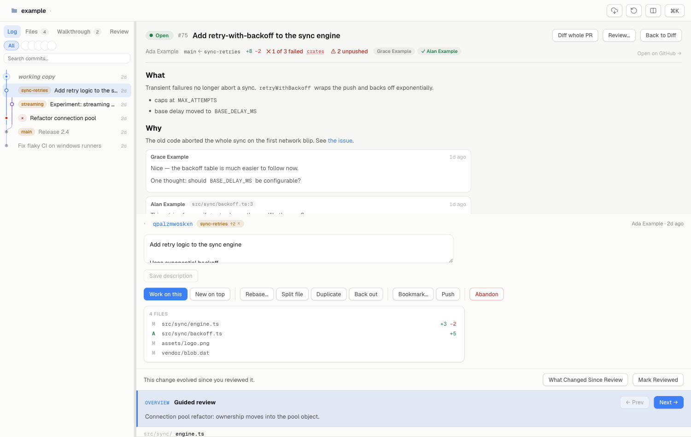

# jjdiff

A fast, minimal desktop app for reviewing and landing changes in
[Jujutsu](https://jj-vcs.dev) colocated repos. Tauri 2 + Rust + Lit.
jj-native from day one: no staging axis, change-id identity, stack review.



## Why jj-native

- **No staging axis.** The working copy *is* a commit. The loop is
  edit → review `@` → describe → new; partial commits are squash and split,
  not `git add -p`.
- **Change ids are identity.** Viewed flags, review comments and walkthroughs
  key on the change id, so they survive `describe`, `squash` and rebases.
  Structurally impossible in git; trivial in jj.
- **Review the stack, not just a diff.** A sidebar over `trunk()..@`,
  per-change review, "what changed since I last reviewed" interdiffs, and
  moving files or hunks between changes.

## What it does

**Review.** Live working-copy diff (the filesystem vs `@-`, never a snapshot)
or any revset; split or unified; word-level intra-line spans; whitespace
toggle; expand-context; images side by side and rendered markdown. Virtualized
and keyboard-first — `j`/`k` files, `n`/`p` hunks, `v` viewed, `⌘F` to find.
Press `?` for the full list.

**Act.** Describe (with generated messages), new, edit, squash and split by
file *or by hunk*, absorb, rebase from a picker or by drag, backout,
duplicate, abandon, restore. Bookmarks, fetch, push, ahead/behind. The
operation log is a first-class tab and every mutation reports what it did
with an Undo that reverts exactly that operation. Conflicts are navigable by
region and resolvable in-app.

**Walkthroughs.** One click turns a change into a guided review: an agent CLI
(claude, codex, opencode or pi) writes a reading order over the diff plus an
overview document — impacted systems, changed contracts, new state and
effects — with steps that filter the diff to their hunks. Agents can also
author walkthroughs headlessly via `--print-hunks` and `--walkthrough-file`.

**Pull requests.** `jjdiff pr 75` fetches the head and reviews it like any
other change: reviewers, merge state and CI checks above the diff, the
conversation alongside it, and the inline comments you accumulated submitted
back as the review. Driven by `gh` — jjdiff never handles tokens, and your
own branch's PR surfaces itself when its checks change. GitHub only.

**And the rest.** jj workspaces (create one for a change without leaving the
tree you're in), one window per repo, nineteen named themes plus light/dark,
a command bar mirrored into the native menu, open-in-editor, and a CLI that
is the same binary as the app.

## Install

Prebuilt, signed and notarized **macOS** builds (universal: Apple Silicon and
Intel) are on the [releases page](https://github.com/valpinkman/jjdiff/releases).
Linux builds from source below — CI keeps that compile green. Windows is
untested.

From source, with Rust (stable), Node 20+, pnpm and `jj` ≥ 0.33:

```bash
pnpm install
pnpm tauri build
```

Either way, put `jjdiff` on PATH with the in-app menu item or
`jjdiff --install-terminal-helper`.

## Usage

```bash
jjdiff                     # the repo you're in
jjdiff -R /path/to/repo    # another repo
jjdiff 'trunk()..@-'       # open on a revset
jjdiff -w                  # ... and generate a walkthrough
jjdiff pr 75               # review a GitHub pull request
jjdiff --diff @            # headless: the structured diff as JSON
jjdiff --print-hunks       # headless: hunk ids, for agents
```

## Configuration

`~/.config/jjdiff/config.toml`, same convention as jj itself:

```toml
[ui]
diff-style = "split"    # or "unified"
theme = "system"        # "light" / "dark" / any palette in the theme picker

[keymap]
command-bar = "Mod+k"   # Mod is Cmd on macOS, Ctrl elsewhere

[editor]
# Placeholders: {file} (absolute), {line}, {repo}. No shell — split on spaces.
command = "zed {file}:{line}"
```

Settings (`⌘,`) writes to this file one key at a time; your comments and key
order survive.

## Development

```bash
pnpm install
pnpm tauri dev                          # app against the cwd repo
pnpm tauri dev -- -- -R /path/to/repo   # against another repo
pnpm dev                                # UI only, in a browser, on mock data

cargo test --workspace
cargo clippy --workspace --all-targets -- -D warnings
pnpm build                              # typecheck + bundle the UI
```

`pnpm build` must precede any `cargo` command in a clean checkout.
`pnpm release` bumps the version, updates the changelog, tags and pushes;
the tag triggers the signed release build. See [CLAUDE.md](CLAUDE.md) for the
rules of the codebase and [PLAN.md](PLAN.md) for how it got here.

## Layout

- `crates/vcs` — the only place that shells out to `jj` (read/mutate discipline, JSONL templates)
- `crates/diff` — patch parsing and filesystem-vs-tree diffing
- `crates/watch` — op-head and working-copy watchers (change detection without polling)
- `src-tauri` — app shell, IPC commands, headless CLI
- `ui` — Lit frontend (light-DOM code pane)

## License

[MIT](LICENSE)
